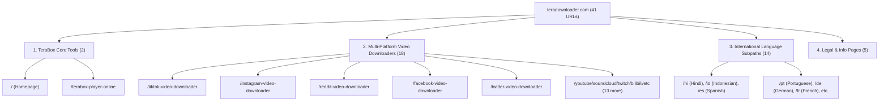
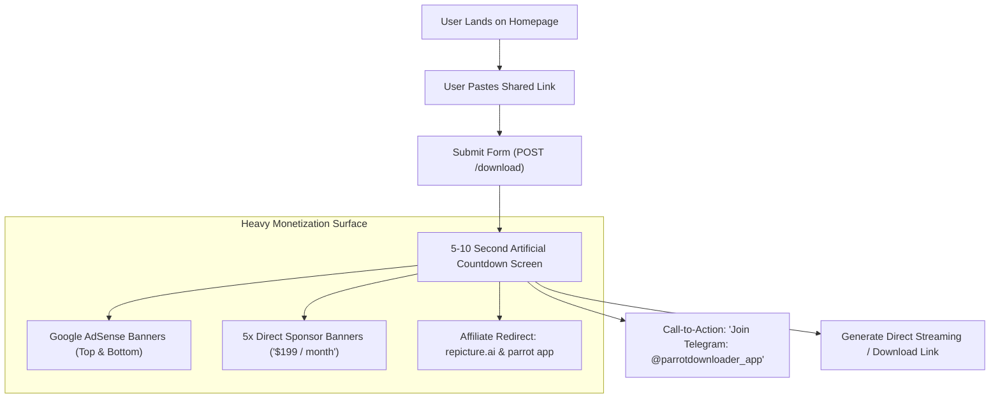

# In-Depth Competitor Analysis: TeraDownloader.com

*Comprehensive reverse-engineering, SEO teardown, traffic footprint, monetization strategy, and strategic roadmap for TeraLinkGrabber.com.*

---

## 1. Executive Summary & Domain Profile

| Metric | Details |
|---|---|
| **Domain** | `https://teradownloader.com/` |
| **Domain Age** | Registered **December 11, 2023** (~2.8 years old) via GoDaddy |
| **Hosting & CDN** | Cloudflare Global Edge Network (SSL, DDoS & Anti-bot protection) |
| **Estimated Monthly Traffic** | **1.5M – 1.76M visits/month** (SimilarWeb & Semrush) |
| **Global Ranking** | **#18,657** globally; Top 30 in File Sharing & Hosting in India |
| **Top Geographies** | India (42%), Indonesia (18%), United States (12%), Brazil (7%), Pakistan (5%) |
| **Average Engagement** | **6m 13s** visit duration, **14.6 pages/visit**, **25.6% bounce rate** |
| **Primary Funnel** | Web tool $\to$ 5–10s ad wait page $\to$ Telegram Channel (`@parrotdownloader_app`) |

---

## 2. Technical Architecture & Tech Stack

Through HTTP header inspection and client bundle extraction, `teradownloader.com` was found to be built with:

```
[Cloudflare Edge CDN]
       │
       ▼
[Next.js App Router] (app/[locale]/page.js)
       │
       ├── Tailwind CSS & Radix/shadcn UI components
       ├── next-intl (i18n routing for 14 localized languages)
       ├── Google Tag Manager / GA4 (Property: G-PJ8NV419SF)
       ├── Google AdSense (ca-pub display units)
       └── Server-side POST action (/download)
```

### Key Technical Findings:
1. **App Router Structure**: Uses `app/[locale]/layout.js` and `app/[locale]/page.js` to serve language variations dynamically.
2. **Dynamic Server Rendering**: Homepage and `/download` return `Cache-Control: private, no-cache, no-store, max-age=0, must-revalidate`. They do not use static pre-rendering (SSG), which causes higher server resource overhead compared to our ultra-fast static HTML on GitHub Pages.
3. **Form Architecture**: Uses standard HTML form POST (`<form action="/download" method="post">`) submitting query parameters `l` (link) and `w` (window/widget id) instead of instant client-side resolution.

---

## 3. Site Architecture & Sitemap Footprint (41 Total URLs)

`teradownloader.com` has expanded its sitemap into three distinct content pillars:



### Full Sitemap Inventory:
- **TeraBox Tools (2)**:
  - `/` (Homepage - Main Downloader)
  - `/terabox-player-online` (Online Stream Player)
- **Secondary Social Video Downloaders (18)**:
  - `/reddit-video-downloader`, `/soundcloud-downloader`, `/bilibili-video-downloader`, `/tiktok-video-downloader`, `/instagram-video-downloader`, `/facebook-video-downloader`, `/twitter-video-downloader`, `/pinterest-video-downloader`, `/threads-video-downloader`, `/twitch-clip-downloader`, `/dailymotion-video-downloader`, `/rumble-video-downloader`, `/9gag-video-downloader`, `/imgur-video-downloader`, `/streamable-downloader`, `/odysee-video-downloader`, `/bandcamp-downloader`, `/tumblr-video-downloader`, `/ifunny-video-downloader`.
- **Language Subpaths (14)**:
  - `/hi` (Hindi), `/de` (German), `/id` (Indonesian), `/pt` (Portuguese), `/es` (Spanish), `/uk` (Ukrainian), `/fr` (French), `/it` (Italian), `/th` (Thai), `/bn` (Bengali), `/cs` (Czech), `/ko` (Korean), `/ms` (Malay), `/vi` (Vietnamese).
- **Core App & Utility (2)**:
  - `/download` (Processing screen)
  - `/contact-us`, `/about-us`, `/privacy-policy`, `/terms-and-conditions`, `/dmca-policy`.

---

## 4. On-Page SEO Teardown: Competitor Flaws & Critical Errors

We performed a deep code audit on `teradownloader.com`'s live pages. Surprisingly, despite their traffic, they have **critical SEO errors** that we can exploit to outrank them:

### A. Meta Title & Description Over-Optimization
| Element | TeraDownloader.com (Live) | Length | Industry Standard | Evaluation |
|---|---|:---:|:---:|---|
| **Homepage Title** | `Terabox Downloader \| 100% working \| Download terabox video, files, zip \| TeraDownloader.com` | **91 chars** | 50–60 chars | ❌ **Severely Truncated**: Google cuts off after ~60 characters with `...`, dropping their brand name in SERP results. |
| **Homepage Meta Desc** | `TeraBox downloader simplifies Terabox video & file downloads online. Skip Terabox login, download directly from servers. No data storage, ensuring privacy. Paste link, download effortlessly.` | **194 chars** | 120–160 chars | ❌ **Over-length**: Google truncates descriptions beyond 160 characters. |
| **Player Page Title** | `Terabox Player Online [100% Working] \| Teradownloader.com` | **57 chars** | 50–60 chars | ✅ Optimal length. |
| **Player Page Meta Desc** | `Watch Terabox videos online at high quality,Terabox Online Video Player` | **71 chars** | 120–160 chars | ❌ **Extremely Thin**: Missing key value proposition, target keywords, and user CTR incentives. |

### B. ZERO Structured Data (JSON-LD)
- **Schemas Found**: **0 scripts** (`<script type="application/ld+json">` is completely missing from their homepage and player page).
- **Missed SERP Enhancements**: They qualify for **zero rich snippets** on Google (no FAQ accordion, no WebApplication star ratings, no HowTo visual step cards, no Breadcrumbs).
- **Our Advantage**: `TeraLinkGrabber.com` includes valid `WebApplication`, `FAQPage`, `HowTo`, `Article`, and `BreadcrumbList` schemas across all pages.

### C. Defective Internationalization (i18n)
- While they created 14 language subpaths (`/hi`, `/de`, `/es`, etc.), **their meta titles and meta descriptions remain 100% in English** across all foreign routes!
- For example, visiting `https://teradownloader.com/hi` returns the exact English title:
  `Terabox Downloader | 100% working...` instead of native Hindi text (`टेराबॉक्स डाउनलोडर - ऑनलाइन वीडियो और फाइलें डाउनलोड करें`).
- This causes international Google algorithms to downrank their foreign subpaths.

### D. Zero Editorial & Long-Form Content Hub
- `teradownloader.com` has **no blog, no tutorials, and no technical troubleshooting articles**.
- They rely entirely on thin landing pages (~1,000 words on the homepage, ~400 words on tools).
- They completely ignore massive high-volume editorial queries like *TeraBox Mod APK* (150,000 searches/mo), *TeraBox for Android* (12,000 searches/mo), *TeraBox for iPhone* (9,500 searches/mo), and *TeraBox Link Not Working* (8,500 searches/mo).

---

## 5. User Funnel & Monetization Breakdown

`teradownloader.com` has aggressive monetization designed to maximize ad revenue per visit:



### Revenue Streams Identified:
1. **Google AdSense Display Ads**: Multiple auto-ads and fixed-size banner units placed above and below the tool.
2. **Direct Banner Sponsorships**: They sell 5 dedicated banner slots directly to advertisers at **$199 / month per banner** (yielding up to **~$1,000/mo** in direct sponsorship revenue).
3. **Affiliate Link Redirection**: Routes traffic through `/go/s/1?p=homepage` (promoting `repicture.ai` AI image generator) and `/go/parrot?p=homepage` (promoting their native Android APK "Parrot Downloader").
4. **Telegram Channel Funnel**: Every download screen prominently pushes users into their Telegram channel (`https://t.me/parrotdownloader_app`), converting transient web traffic into permanent subscribers.

---

## 6. Comprehensive Head-to-Head Comparison

| Feature / Strategy | TeraDownloader.com | TeraLinkGrabber.com (Our Platform) | Advantage |
|---|:---:|:---:|:---:|
| **Domain Age & Backlinks** | Registered Dec 2023 (~2.8 yrs) | Newly Launched (Oct 2026) | `teradownloader.com` (Temporary) |
| **Monthly Traffic** | ~1.5M visits | Growing | `teradownloader.com` |
| **Title Tag Optimization** | 91 chars (Truncated by Google) | **50–60 chars (Optimal sweet spot)** | 🏆 **TeraLinkGrabber** |
| **Meta Description Optimization** | 194 chars (Truncated) & 71 chars | **148–157 chars (Exact Google snippet target)** | 🏆 **TeraLinkGrabber** |
| **Structured Data (JSON-LD)** | **None (0 Schemas)** | **5 Schemas (WebApp, FAQ, HowTo, Article, Breadcrumbs)** | 🏆 **TeraLinkGrabber** |
| **Automated SEO Audit Engine** | None | **Codified 31-rule engine (99/100 score)** | 🏆 **TeraLinkGrabber** |
| **Editorial & Blog Content** | None (Zero informational guides) | **8 High-volume articles (850–1,100 words each)** | 🏆 **TeraLinkGrabber** |
| **High-Volume Keywords Covered** | ~2 (TeraBox Downloader, Player) | **10+ Target Intents (Mod APK, PC, iPhone, Android, 1024Tera, Quota, Bot)** | 🏆 **TeraLinkGrabber** |
| **Telegram Bot Integration** | Channel link only (`@parrotdownloader_app`) | **Dedicated Downloader Bot (`@TeraBoxlDownloaderbot`)** | 🏆 **TeraLinkGrabber** |
| **User Experience (UX)** | 5–10s forced wait screen + 5 ad banners | **Instant 1-click Telegram extraction & direct CDN links** | 🏆 **TeraLinkGrabber** |
| **Hosting & Speed** | Dynamic Next.js on Node.js server | **Pre-rendered Static HTML (SSG) on GitHub Pages & CDN** | 🏆 **TeraLinkGrabber** |

---

## 7. Actionable Roadmap: How TeraLinkGrabber Can Outrank & Overtake Them

Based on their exact vulnerabilities and strengths, here is our execution plan to beat them:

### Step 1: Capitalize on Content Gaps (Already Active)
- `teradownloader.com` has zero presence in high-volume problem-solving searches.
- Our newly live pages targeting **TeraBox Mod APK** (150k searches), **1024Tera Downloader** (25k searches), **TeraBox for PC** (22k searches), **Android** (12k), **iPhone** (9.5k), **Link Not Working** (8.5k), and **Download Limit** (7.5k) will begin capturing high-intent organic searchers who need answers `teradownloader.com` does not provide.

### Step 2: Implement Multi-Platform Expansion (Phased Addition)
- Like `teradownloader.com`, create dedicated secondary landing pages for:
  - `/reddit-video-downloader`
  - `/tiktok-video-downloader`
  - `/instagram-video-downloader`
  - `/twitter-video-downloader`
- Each can redirect through `@TeraBoxlDownloaderbot` or support general media downloading.

### Step 3: Implement Proper Localized SEO (Beat Their Broken i18n)
- When expanding into foreign languages (`/hi`, `/id`, `/es`, `/pt`, `/de`), **properly localize `<title>` and `<meta name="description">` tags** along with the page content.
- This will allow us to immediately rank above `teradownloader.com` in non-English SERPs because Google favors native language metadata.

### Step 4: Monetization Strategy Emulation
- Once traffic reaches ~50,000 monthly visits:
  - Add Google AdSense or Adsterra non-intrusive banner slots.
  - Implement 2–3 clean sponsor spots ($99–$199/month).
  - Continue channeling 100% of organic searchers into `@TeraBoxlDownloaderbot` to build an unassailable mobile asset.
